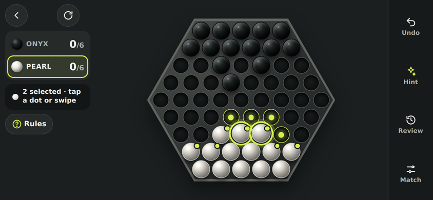
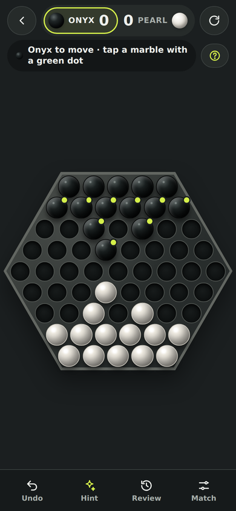
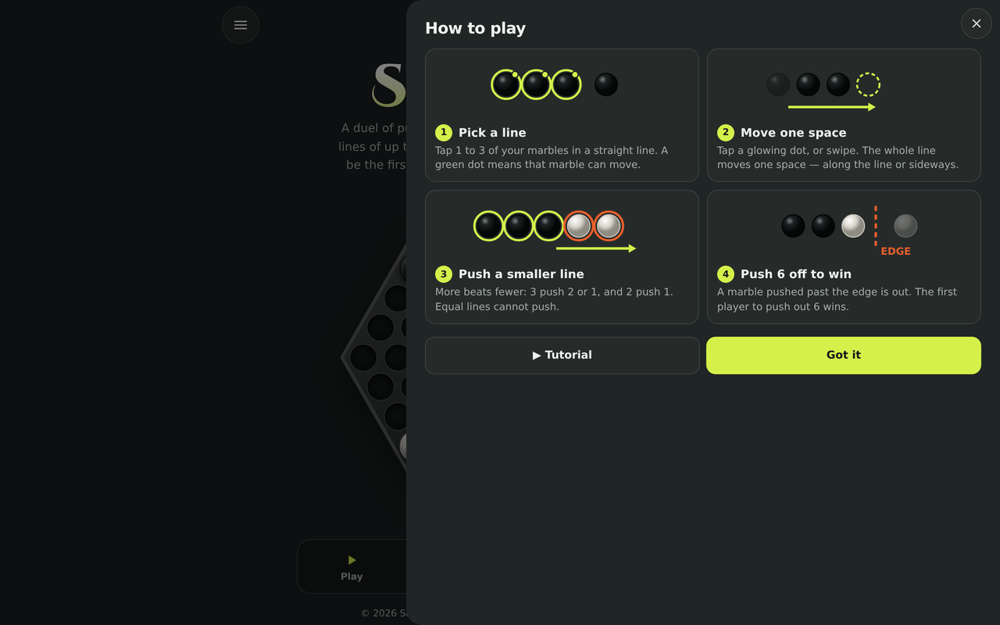

# Sumito

**A free, open-source game of push and position on a hexagon board.**
Slide lines of up to three marbles, outnumber your rival, and be the first to push six of their marbles off the edge.

**▶ Play now: [sumito.kashifaziz.me](https://sumito.kashifaziz.me)**



[](https://github.com/kashaziz/sumito/actions/workflows/ci.yml)
[](LICENSE)

## Features

- **Play a friend** on one device, or **play the computer** at three levels. The computer explains its moves.
- **Learn fast**: a one-minute tutorial on the real board, hints, four picture rules, and three short puzzles.
- **Review and share**: step through any match and share the replay with one link.
- **Every screen**: mobile first, with a full-height landscape layout, a desktop layout, and safe areas for notched phones.
- **Feels good**: transform-only animation, synthesized sound effects, a win celebration, and a reduced-motion setting.
- **Installable and offline**: a progressive web app (PWA) with a service worker.
- **No accounts, no ads, no tracking.** See the [privacy page](https://sumito.kashifaziz.me/privacy).

| Phone | Desktop |
|---|---|
|  |  |

## How to play

1. **Pick a line.** Tap 1 to 3 of your marbles in a straight line. A green dot shows which marbles can move.
2. **Move one space.** Tap a glowing dot, or swipe. The line moves along itself or sideways.
3. **Push a smaller line.** More beats fewer: 3 push 2 or 1, and 2 push 1. Equal lines cannot push.
4. **Push 6 off to win.** A marble pushed past the edge is out.

The [learn page](https://sumito.kashifaziz.me/learn) has strategy notes and the three openings.

## Run it locally

Requirements: **Node.js 22.13+**. Python 3.11+ is optional (for the research tests).

```bash
git clone https://github.com/kashaziz/sumito.git
cd sumito
npm install
npm run dev          # http://localhost:3000
```

| Command | What it does |
|---|---|
| `npm run dev` | Development server with hot reload |
| `npm run build` | Production build into `dist/` |
| `npm start` | Serve the production build locally |
| `npm test` | Engine, UI, and Python tests, a production build, and rendered-HTML tests |
| `npm run typecheck` | TypeScript check |
| `npm run lint` | ESLint |
| `npm run qa:mobile` | Real-browser QA (see below) |
| `npm run deploy` | Build and deploy to Cloudflare Workers |

### Browser QA

`tests/mobile-browser-qa.mjs` drives headless Chrome over the DevTools protocol. It checks four screen sizes, phone landscape, notch safe areas, taps, drags, swipes, keys, the computer opponent, panels, motion, sound events, and the content pages (162 checks).

```bash
npm run build && npx vinext start --port 3197 &
google-chrome --headless=new --remote-debugging-port=9336 about:blank &
CDP_PORT=9336 SUMITO_URL=http://127.0.0.1:3197 npm run qa:mobile
```

## Deploy your own copy

Sumito runs on [Cloudflare Workers](https://developers.cloudflare.com/workers/) through [vinext](https://github.com/cloudflare/vinext).

```bash
npx wrangler login
npm run deploy       # creates the Worker "sumito" on your account
```

To serve a custom domain on a Cloudflare zone you own, create a `.env` file (it is git-ignored):

```bash
SUMITO_CUSTOM_DOMAIN=sumito.example.com
```

Wrangler then creates the DNS record and certificate, and the Worker redirects its `workers.dev` address to that domain. Wait about a minute after a deploy before testing: an edge can briefly serve new HTML before its CSS arrives.

## Project layout

```text
app/                 Routes: / (game), /learn, /about, /privacy
app/game/            Game UI: board, sheets, motion, sound, AI worker hook, icons
app/ai.worker.ts     Web Worker for computer moves and hints
lib/game/            Pure rules engine, computer opponent, puzzles, UI geometry
worker/              Cloudflare Worker entry (redirect, image optimisation)
public/              Icons, manifest, service worker, link-preview image
research/            Python rules copy and multi-agent environment for AI experiments
tests/               Engine, UI, rendered-HTML, and browser QA tests
docs/                Architecture and AI notes
STYLE.md             Style guide and design tokens
```

More detail: [docs/architecture.md](docs/architecture.md), [docs/ai-opponent.md](docs/ai-opponent.md), [docs/ai-and-rl.md](docs/ai-and-rl.md), and [STYLE.md](STYLE.md).

## Contributing

Bug reports, ideas, and pull requests are welcome. Please read [CONTRIBUTING.md](CONTRIBUTING.md) and the [Code of Conduct](CODE_OF_CONDUCT.md). To report a security issue, see [SECURITY.md](SECURITY.md).

## Disclaimer

Sumito is an independent, open-source game inspired by the board game **Abalone**, designed by Michel Lalet and Laurent Lévi (1987). Abalone is a trademark of its respective owner. Sumito is **not affiliated with, endorsed by, or sponsored by** the Abalone trademark owner or publisher. All code, artwork, sounds, and text in this repository are original.

## Credits and licence

Designed and developed by [Kashif Aziz](https://kashifaziz.me). Title fonts: Cinzel and Cinzel Decorative by Natanael Gama (SIL Open Font License), served by Google Fonts.

Released under the [MIT licence](LICENSE).
